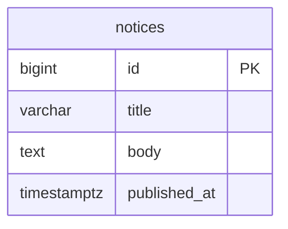

# BD-001 （サンプル）お知らせ一覧の基本設計

## 1. 概要

FR-001 を、一覧画面・一覧 API・notices テーブルで実現する。

## 2. 画面設計

### 2.1 画面一覧

| 画面 ID | 画面名 | URL パス | 利用ロール | 対応 FR |
|---|---|---|---|---|
| SCR-01 | お知らせ一覧 | `/` | 全員 | FR-001 |

### 2.2 画面遷移

該当なし

### 2.3 画面項目

| 画面 ID | 項目 | 表示/入力 | 必須 | 入力チェック | 備考 |
|---|---|---|---|---|---|
| SCR-01 | 公開日時 | 表示 | - | - | `YYYY/MM/DD HH:mm` |
| SCR-01 | タイトル | 表示 | - | - | |

## 3. API 一覧

| API ID | メソッド | パス | 概要 | 認可 | 対応 FR |
|---|---|---|---|---|---|
| API-01 | GET | `/api/notices` | 公開済みお知らせの一覧（ページング） | なし | FR-001 |

## 4. データ設計

### 4.1 テーブル一覧

| テーブル | 概要 | 主な列 | 想定件数 | 個人情報 |
|---|---|---|---|---|
| notices | お知らせ | id, title, body, published_at | 年 100 件程度 | なし |

### 4.2 ER 図

## 5. 認証・認可

サンプルのため対象外

## 6. 非機能要件への対応

該当なし

## 7. 外部システム連携

なし

## 8. 参照（REF）

REF-006, REF-007

## 9. 未決事項

なし

## 変更履歴

| 日付 | 変更者 | 内容 |
|---|---|---|
| 2026-11-22 | sample | 初版 |
